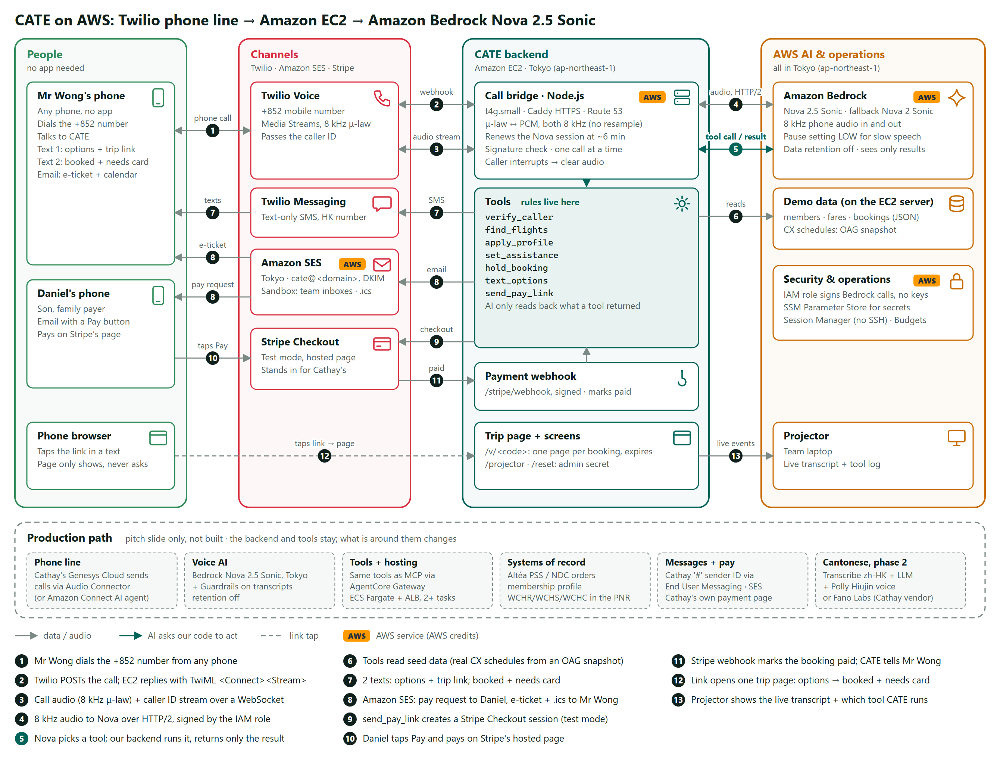

# CATE: Cathay Automated Travel Expert

Book a Cathay flight by phone call, with no app, no forms and no codes.

CATE is a voice assistant for travellers who find online booking hard: older travellers, and people with visual, cognitive or communication needs. The traveller calls a phone number and says their trip and their needs once, in their own words. CATE finds the flights, sets the wheelchair assistance, reads everything back, and holds the booking. A family member pays through a link sent to them. The traveller gets the booking and a "needs card" by text, to show staff at check-in, immigration and the gate.

Built for **Cathay Hackathon 2026**, challenge *Premium Travel: Making Travel More Accessible*, by team **E332 Coelas Hackers**.

> **Status: work in progress.** The booking logic, server, screens and payment loop run end to end with a scripted stand-in for the voice model. The live voice model, real schedules and live messages are next. The [Status](#status) table below shows what exists.

## How a call works

The demo follows one caller, Mr Wong (74), who wants to visit family in Vancouver:

1. **Verify.** Mr Wong calls from his own phone. CATE matches the caller ID to his membership and asks one question from his travel history: "Where did you last fly with us?"
2. **Say the trip.** "Vancouver after Chinese New Year, back before Ching Ming. Window seat, not too early."
3. **Options.** CATE reads 2–3 options slowly, from the schedule and ranked by his profile, and offers to text them with a large-text link.
4. **Assistance.** "Wheelchair to the gate, like Osaka?" CATE sets the IATA code (WCHR / WCHS / WCHC) from a fixed rule table and reads it back in plain words.
5. **Read-back and hold.** CATE reads the whole trip back and holds the booking only after he says yes.
6. **Family pays.** His son Daniel, linked to his profile, gets the pay request.
7. **Booked.** Mr Wong gets a text with the booking reference and his needs card.
8. **Next time.** On his next call: "Same as your Vancouver trip?"

## Core rule: the AI talks, our code decides

The voice model only listens, talks and chooses which tool to call. Every action that matters runs as a tool in our code, with its rule enforced there:

- **Names** come from the verified member profile, never from speech, so the ticket matches the passport.
- **Flights and fares** come from our data. The model can't invent a flight or a price.
- **Wheelchair codes** come from a fixed rule table, not from the model's judgement.
- **Nothing about the member** reaches the model before verification passes, and the model never sees the correct verification answer.
- **General Cathay answers** come only from checked passages, each with its source. With no relevant passage, CATE says it does not have that information and offers a member of staff.

The 8 tools, with their inputs, results and rules, are documented in [`docs/TOOLS.md`](docs/TOOLS.md).

## Architecture



```
Caller's phone ──► Twilio (phone number, call audio 8 kHz μ-law, SMS)
                     │ WebSocket
                     ▼
                  CATE server (Node.js, Amazon EC2, Tokyo)
                    ├─ tools: verify_caller · apply_profile · find_flights · set_assistance
                    │         hold_booking · text_options · send_pay_link
                    ├─ cathay.js ──► mock Cathay systems (Membership · Orders · Schedule)
                    ├─ trip pages (view-only links) · projector view
                    │
                    └─ two-way audio stream ──► Amazon Bedrock: Nova 2 Sonic (speech to speech)
```

**Mocked for the demo.** We have no access to Cathay's systems, so the server includes mock Membership, Orders and Schedule systems behind one adapter (`src/cathay.js`). Their operations are modelled on public IATA NDC message names (`OrderCreate`, `AirShopping`). In production, that adapter points at Cathay's membership and booking systems and nothing else changes. Fares are illustrative. Flight schedules are placeholders until they are replaced by an OAG schedule snapshot. Payment is in test mode; no money moves.

## Status

| Part | State |
|---|---|
| Module contracts (`CONTRACTS.md`), configuration, event log, in-memory store, seed data | ✅ Done |
| Mock Cathay systems + adapter, the 7 booking tools and their rules | ✅ Done, tested |
| Server: Twilio webhook and call audio, signature checks, view-only pages, reset | ✅ Done, tested with simulated requests; not yet run against a live Twilio number |
| Screens: projector view, trip page with needs card, texts, pay email | ✅ Done, tested |
| Payment: family member replies PAY by text | ✅ Done, tested |
| Scripted stand-in for the voice model (plays the golden path, no audio) | ✅ Done |
| General Cathay questions (`ask_cathay`): search over passages in `knowledge/`, source shown on the projector | ✅ Tool and keyword search done, tested. The 23 passages are drafts, not yet verified against Cathay's pages. Search by meaning (embeddings) is planned. |
| Voice model: Amazon Nova 2 Sonic over the call audio | Planned |
| Real schedules (OAG snapshot), live SMS and email, Stripe test checkout | Planned |

## Repo layout

```
CONTRACTS.md          interfaces between modules (read before writing code)
CLAUDE.md             working rules for this repo
data/                 seed data for the mock Cathay systems (JSON)
docs/                 architecture diagram, TOOLS.md (the 8 tools)
src/server.js         HTTP routes, projector feed, wiring
src/twilio.js         call webhook, call audio stream, PAY reply
src/mulaw.js          phone audio conversion (G.711 mu-law <-> PCM)
src/tools.js          the 8 tools and their rules
src/knowledge.js      search over the knowledge passages (for ask_cathay)
knowledge/            general Cathay knowledge: short passages, each with source and date checked
src/cathay.js         the one adapter to Cathay's systems
src/mock-cathay/      mock Membership, Orders and Schedule systems
src/model/            voice model drivers (scripted.js; nova.js to come)
src/screens/          projector view, trip page, texts, emails
src/payment.js        what happens when a booking is paid
src/messages.js       SMS and email sending (log or live)
src/config.js, events.js, store.js   settings, event bus + run log, in-memory state
test/                 node --test; golden.test.js plays the whole booking
```

## Run it

Requires Node.js 22 or later.

```sh
npm install
cp .env.example .env     # then fill in your own values
npm test                 # node --test
npm start                # node src/server.js; prints the projector address
```

To play the whole booking without a phone (`MODEL=scripted`), open the projector address in a browser, then:

```sh
curl -X POST -H "x-admin-key: <ADMIN_SECRET>" http://localhost:8080/dev/simulate          # the call
curl -X POST -d "From=%2B85200000002&Body=PAY" http://localhost:8080/twilio/sms           # Daniel pays
curl -X POST -H "x-admin-key: <ADMIN_SECRET>" http://localhost:8080/reset                 # start again
```

The trip page link is printed in the server console with the text message.

All settings are in `.env.example`. `MODEL=scripted` runs the golden path without a voice model, and `MESSAGES=log` prints texts and emails to the console instead of sending them.

## Privacy and security

- **No real personal data in git.** The demo caller's and family member's real phone numbers live only in `.env` (never committed); the seed data uses placeholders.
- **Minimum data to the model.** After verification the model gets name, preferences, needs and recent trips, never phone numbers, email addresses or the family member's contact details.
- **View-only links.** Trip pages open only from a 128-bit random link created during a call. They are read-only, never indexed, never cached, and show only name, flights and needs.
- **Signed requests.** Every request from Twilio (and from Stripe) is checked for its signature. The projector view and reset need an admin secret.
- **One call at a time,** so a second caller can't change the demo's state.

## Licences

Direct dependencies: [`ws`](https://github.com/websockets/ws) (MIT) and [`twilio`](https://github.com/twilio/twilio-node) (MIT). All 53 installed packages, including indirect ones, use permissive licences (MIT, BSD-3-Clause, Apache-2.0, ISC); none is copyleft. All code in this repo was written for this hackathon.
